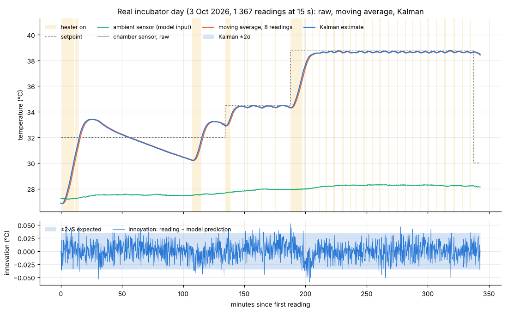
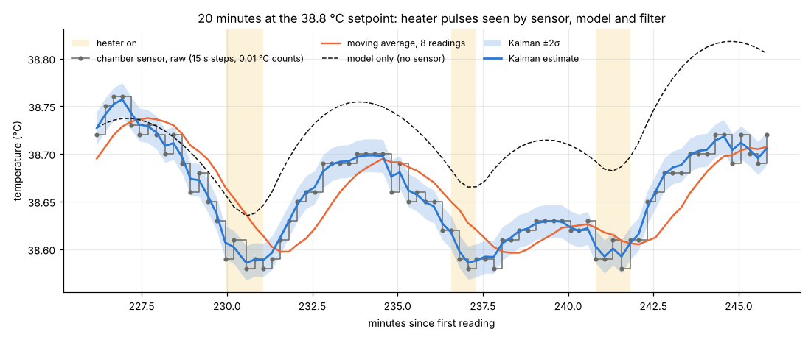
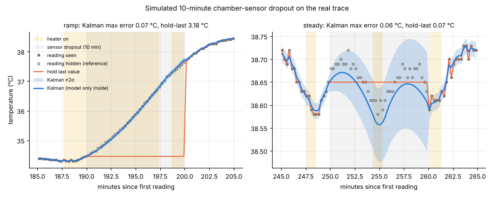
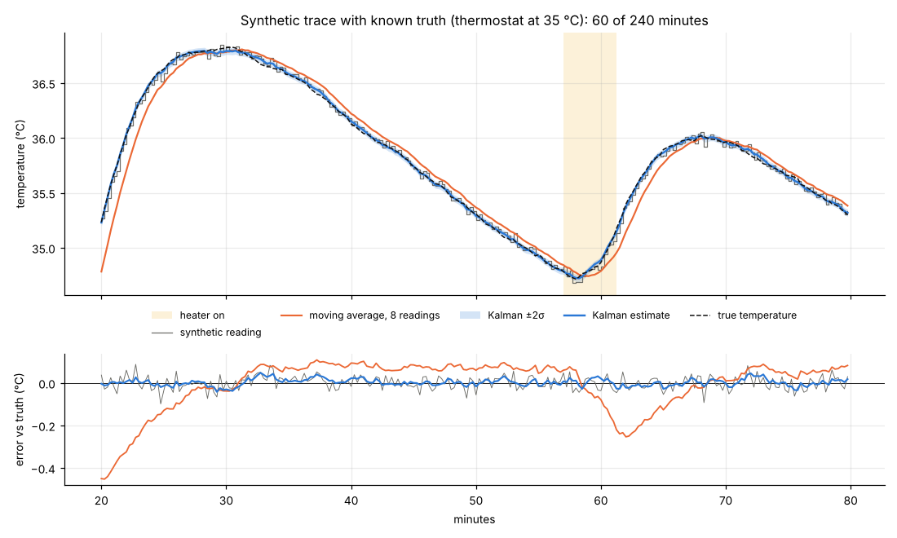

# sensor-fusion-kalman-1d

[](https://github.com/Mariam-zeqred/sensor-fusion-kalman-1d/actions/workflows/ci.yml)

A one-dimensional Kalman filter that turns a queen-bee incubator's three signals, the chamber
SHT31, the ambient SHT31 and the heater relay, into one smoothed chamber-temperature estimate
with an uncertainty. It runs on a real day of 15-second telemetry copied from
[incubator-telemetry-analysis](https://github.com/Mariam-zeqred/incubator-telemetry-analysis)
and is compared with the raw reading and a moving average, including what each does when the
chamber sensor drops out for ten minutes. Every number below is in `figures/results.json`,
written by `python -m kalman1d`.

```
data/hive-1C5A00_history_2026-10-03.json ──► data.py ──► Trace(t, temp, temp_out, heater, target)
data/model_params.json ─────────────────────► model.py ──► ThermalModel(a, b, τh)
                                                              │
      heater relay ──► heat input E(t) (lagged) ──┐           │
      ambient sensor ─────────────────────────────┼─► predict: x⁻, P⁻   (filter.py)
      chamber sensor ─────────────────────────────┴─► update:  x, P  ──► estimate ± σ
                                                              │
      baselines.py: moving average, hold-last ◄───────────────┤
      synthetic.py: thermostat trace with known truth ◄───────┤
      report.py ──► figures/*.png, figures/results.json ◄─────┘
```

## The filter, written out

The chamber is modelled with the heater-lag fit from the source repo (open-loop error 0.16 °C
RMS over this day):

```
dE/dt = (a·u − E) / τh          E: heat reaching the chamber (°C/min), u: relay 0/1
dT/dt = E − b·(T − T_out)        T: chamber (°C), T_out: ambient sensor (°C)
a = 0.591 °C/min, b = 0.0111 1/min (time constant 90 min), τh = 4.9 min
```

`E` depends only on the relay history, so it is computed once (`ThermalModel.heat_input`) and
the Kalman state is the single number `T`. For each reading `k`, with step `dt` minutes:

```
predict   x⁻ = x + dt·(E − b·(x − T_out))          P⁻ = F²·P + q²·dt,   F = 1 − b·dt
update    K  = P⁻ / (P⁻ + r²)                      (skipped when the reading is missing)
          x  = x⁻ + K·(z − x⁻)                      P  = (1 − K)·P⁻
```

`z` is the chamber reading, `r` the sensor-noise standard deviation (°C), `q` the process-noise
standard deviation (°C per √minute: how far the real chamber can drift from the model per unit
time). The ambient sensor and the relay are *inputs* that drive the prediction, not
measurements of `T`; that is how three signals are fused into a one-state filter. `P⁻ + r²` is
the innovation variance `S`; the filter reports `√P` as its uncertainty.

Both noise levels come from the data, not by hand:

- `r` from the second difference of the readings (`estimate_measurement_std`): for a smooth
  signal plus white noise, `z[k+1] − 2z[k] + z[k−1]` has variance `6r²`. Result on the real
  trace: **r = 0.012 °C**, about one count of the 0.01 °C resolution.
- `q` by maximising the Gaussian log-likelihood of the innovations over a 41-point grid
  (`tune_process_noise`). Result: **q = 0.018 °C/√min**. The mean normalised innovation
  squared is 0.92 (1.0 would be perfectly consistent).

With those values the filter settles, on the 15 s grid, to a gain of 0.51 and a posterior σ of
0.009 °C (closed-form Riccati solution, `KalmanFilter1D.steady_state`; a test checks the
loop converges to it).

## Run it

```bash
git clone https://github.com/Mariam-zeqred/sensor-fusion-kalman-1d && cd sensor-fusion-kalman-1d
python -m venv .venv && . .venv/bin/activate
pip install -r requirements.txt
make check          # ruff + 21 pytest + regenerate figures/ and results.json (~5 s)
```

`make figures` alone re-runs the filter on the real day. The library has no dependency beyond
numpy:

```python
from kalman1d import KalmanFilter1D, ThermalModel, load_history, load_model_params
trace = load_history()
kf = KalmanFilter1D(ThermalModel.from_params(load_model_params()), q=0.018, r=0.012)
res = kf.run(trace)              # res.estimate, res.std, res.innovation, res.gain
res = kf.run(trace.with_dropout(190, 200))   # NaN readings are skipped, P grows
```

## Results

### The whole day


Raw, moving average and Kalman estimate lie on top of each other at this scale, which is the
first honest finding: the SHT31 is quiet (0.012 °C), so on a healthy sensor there is little to
smooth. The lower panel is the diagnostic that matters: the innovation (reading minus model
prediction) against its expected ±2√S band. 3.4 % of readings fall outside it, against the
4.6 % a Gaussian would give; the largest excursions (0.05–0.06 °C) sit mostly at the heater
transitions between minutes 188 and 204, where the model is weakest, with a few one-off
outliers of the same size elsewhere (minutes 31, 265 and 319).

### 15-second steps and 0.01 °C counts


Twenty minutes at the 38.8 °C setpoint. The raw trace is a staircase: one value per 15 s,
quantised to 0.01 °C, jittering by one or two counts. The moving average (8 readings, 2 min)
smooths it but trails every turn by about a minute. The Kalman estimate follows the turns
without the lag because the model knows the heater fired, and its ±2σ band (±0.017 °C) is the
size of the sensor jitter. The dashed line is the model alone, started from the filter's
estimate at minute 226 and never corrected: within 20 minutes it drifts 0.1 °C, which is
exactly the drift `q` describes and the reason the filter needs the sensor.

A gap of 74 s in the real file (one reading late) is just a longer prediction step; nothing
special is done for irregular timing.

### Simulated sensor dropout


The chamber reading is hidden for ten minutes (40 readings) and the filter is scored against
the hidden readings. Hold-last is what a controller does if nothing smarter exists.

| Window (min from start) | Chamber moved | Kalman max error | Kalman σ at end | Hold-last max error |
|---|---|---|---|---|
| 190–200, inside the 10-min heater run towards 38.8 °C | +3.15 °C | **0.07 °C** | 0.054 °C | 3.18 °C |
| 250–260, steady at 38.8 °C with two short pulses | −0.05 °C | 0.06 °C | 0.054 °C | 0.07 °C |

During the ramp the model, fed only with the relay state and the ambient reading, tracks a
3 °C rise to within 0.07 °C, and the reported σ (0.054 °C) is of the right size for that error.
In steady state hold-last is just as good; the value of the filter there is the growing band,
which says how much to trust the estimate.

Caveat: `a`, `b` and `τh` were fitted on this same day in the source repo, so the ramp result
is in-sample. On another day, or after the incubator's fan or insulation changes, the model
error (and so the right `q`) will be larger.

### Synthetic trace with known truth


The real data has no ground truth, so `synthetic.py` generates one: the same thermal model with
a thermostat at 35 °C, 0.01 °C per step of process noise, and readings with 0.03 °C Gaussian
noise rounded to 0.01 °C every 15 s (2.5× noisier than the real sensor; labelled synthetic
everywhere). `r` and `q` are estimated from the synthetic readings with the same recipe
(0.030 °C and 0.020 °C/√min; the generator used 0.030 and 0.020).

| | RMSE vs truth | Mean error while heating |
|---|---|---|
| Raw reading | 0.031 °C | ≈ 0 |
| Moving average, 8 readings | 0.143 °C | −0.32 °C (lags the ramp) |
| Kalman | **0.016 °C** | −0.003 °C |

The truth lies inside the ±2σ band 95.8 % of the time. The tests in `tests/` assert these
properties (filter beats raw and moving average, 90–99 % coverage, no lag while heating,
dropout bridged, still better than raw with 15–30 % wrong model parameters).

## Limitations

- One-dimensional means the heater lag `E` is trusted, not estimated. If the heater ages or the
  relay state is wrong, the filter cannot notice; a two-state filter (`T`, `E`) could.
- Sensor faults other than dropout (stuck value, offset) are not handled: a stuck sensor is
  believed with gain 0.51. Innovation gating (reject `|z − x⁻| > 3√S`) is the standard next step.
- No ground truth on the real day; the dropout experiment uses the hidden sensor readings as
  reference, and the model parameters are in-sample (see caveat above).
- Forward Euler with 15 s steps is fine for a 90-minute time constant; it would not be for a
  gap of many minutes (the prediction should then be sub-stepped).

## Next steps

- Port `KalmanFilter1D.run` to C for the ESP32 (it is five multiplications per reading) and run
  it inside the incubator firmware, using the filter's σ to decide when a reading is suspect.
- Fit `a`, `b`, `τh` on a second day and re-run the dropout table out-of-sample.
- Add innovation gating and a stuck-sensor test case to the synthetic generator.

## Licence

MIT, see `LICENSE`. Data: see `data/README.md`.
